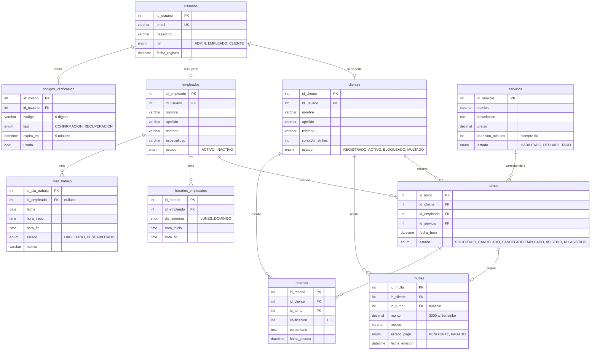

# Modelo de datos — Barberazo

Fuente: `api/database/init_barberazo.sql` (base `dsw`, MySQL 8). Este diagrama se renderiza automáticamente en GitHub.

## Decisiones de modelado

- **Usuarios separado de perfiles:** `usuarios` guarda credenciales y rol; `clientes` y `empleados` guardan datos propios. El alta crea ambas filas en una transacción.
- **Baja lógica en empleados:** `empleados.estado` (`ACTIVO`/`INACTIVO`) conserva el historial de turnos; bloquear la baja si hay turnos `SOLICITADO` futuros.
- **Strikes y multas:** `clientes.contador_strikes` acumula; al llegar a 3 se inserta en `multas` y el cliente pasa a `MULTADO`. El bloqueo manual (`BLOQUEADO`) nunca pisa `MULTADO`.
- **Reseñas atadas a turnos:** `resenas.id_turno` garantiza una reseña por turno asistido.
- **Verificación por código:** `codigos_verificacion` con expiración a 5 minutos para confirmación de registro (CUU2.1) y recupero de contraseña (CUU3.1).
